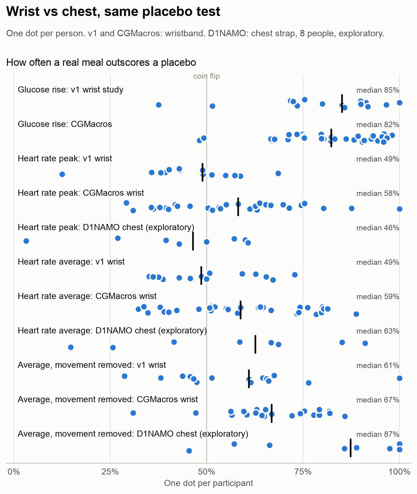

# Placebo meals

**A placebo test for heart rate meal responses, run on public wearable data.**

Wearables that report meal responses need a way to check that the response comes from the meal. To check heart rate, I scored real meals and *placebo moments* the same way. A placebo moment is a time when the same person ate nothing, at the same time of day as a real meal but on a different day. If heart rate responds to food, real meals should score higher.

<picture>
  <source media="(prefers-color-scheme: dark)" srcset="results/figure-dark.png">
  
</picture>

## Result

**Glucose rises far more after real meals than after placebo moments. Heart rate shows no difference.**

| Score | After real meals | After placebo moments | Difference | Real meal scores higher |
|---|---|---|---|---|
| Glucose peak: highest in the {{post_h}} h after, minus the {{pre_min}} min before | {{glucose_meal}} mg/dL | {{glucose_placebo}} mg/dL | {{glucose_diff}} mg/dL | {{glucose_auc}} of the time |
| Heart rate peak: same definition | {{hr_peak_meal}} bpm | {{hr_peak_placebo}} bpm | {{hr_peak_diff}} bpm | {{hr_peak_auc}} of the time |
| Heart rate average: {{sustained_from}} to {{sustained_to}} min after, minus the {{pre_min}} min before | {{hr_sustained_meal}} bpm | {{hr_sustained_placebo}} bpm | {{hr_sustained_diff}} bpm | {{hr_sustained_auc}} of the time |

How to read the table:

- **Every value is a median across {{participants}} people**, taken after summarizing each person.
- **"Difference"** is a person's average after real meals minus their average after placebo moments.
- **"Real meal scores higher"** is the chance that one of a person's real meals beats one of their placebo moments. 50% is a coin flip.

Across people:

- **Glucose** is higher after real meals for {{glucose_positive}} of {{participants}} people ({{glucose_p}}, Wilcoxon signed-rank test).
- **Heart rate peak** is higher for {{hr_peak_positive}} of {{participants}} ({{hr_peak_p}}).
- **Heart rate average** is higher for {{hr_sustained_positive}} of {{participants}} ({{hr_sustained_p}}).

**What it means.** In everyday wrist data, the heart rate peak after a meal reaches about {{hr_peak_meal}} bpm, which looks like a strong response. Placebo moments reach {{hr_peak_placebo}} bpm. A 3-hour peak catches movement, like walking or standing up, along with sensor noise. The movement check below tests that.

Without a placebo comparison, you would read that {{hr_peak_meal}} bpm as a meal response. Glucose, scored the same way, separates meals from placebo moments, so the test can detect a real effect.

These results rule out a large heart rate response to meals in this data. A smaller one could still hide below the detection limits listed under Limitations.

## Movement check

The wristband also records motion, so I repeated the test in two ways that take movement out of the picture. I wrote both down in [ANALYSIS_PLAN.md](ANALYSIS_PLAN.md) before running them.

<picture>
  <source media="(prefers-color-scheme: dark)" srcset="results/movement-dark.png">
  
</picture>

1. **Movement removed.**
   - For each person, I fit a model that predicts heart rate from wrist movement over the current and previous 15 minutes.
   - I fit it on minutes at least {{fit_gap_h}} hours after eating, so a meal effect can't leak in.
   - Movement explains a median {{r2_median}} of minute-to-minute heart rate variation (range {{r2_min}} to {{r2_max}}). The lowest is participant {{r2_min_pid}}, whose heart rate has frequent sensor spikes.
   - I then ran the placebo test on the heart rate that movement doesn't explain:
     - Heart rate peak: a real meal scores higher {{adj_hr_peak_auc}} of the time ({{adj_hr_peak_positive}} of {{adj_hr_peak_participants}} people higher, {{adj_hr_peak_p}}).
     - Heart rate average: {{adj_hr_sustained_auc}} of the time ({{adj_hr_sustained_positive}} of {{adj_hr_sustained_participants}} people higher, median difference {{adj_hr_sustained_diff}} bpm, {{adj_hr_sustained_p}}).
2. **Still periods** (exploratory).
   - I planned to keep meals and placebo moments where at least {{still_share}} of minutes were still, both in the {{pre_min}} min before and from {{sustained_from}} to {{sustained_to}} min after.
   - **People kept moving after most meals.** With the loosest planned threshold ({{still_threshold}} g), {{still_meals}} of {{meals}} meals ({{still_meal_share}}) passed, against {{still_placebos}} of {{placebos}} placebo moments ({{still_placebo_share}}).
   - That left {{still_hr_sustained_participants}} people with enough data, under the planned minimum of {{still_min_participants}}, so I report this comparison as exploratory:
     - Heart rate average: a real meal scores higher {{still_hr_sustained_auc}} of the time.
     - Glucose in the same windows, as a check: {{still_glucose_auc}}.

**What it means.** With movement removed, the peak still can't tell meals from placebo moments, so the large peak comes from something other than the meal.

The average leans toward real meals. With movement removed, heart rate after real meals was higher for {{adj_hr_sustained_positive}} of {{adj_hr_sustained_participants}} people, by a median of {{adj_hr_sustained_diff}} bpm, and a real meal wins {{adj_hr_sustained_auc}} of the time.

The evidence is weak ({{adj_hr_sustained_p}}). The lean also shrinks to {{day_adj_hr_sustained_auc}} when you restrict the test to lunch and dinner, so early-morning and late-night timing around sleep may explain it better than food does. Either way, an effect this small can't tell you anything about a single meal.

## What I'd do next

- **Look for a small heart rate effect under controlled conditions.** Give people the same standardized meal on several days, keep them seated for 2 hours afterward and compare against matched no-meal sessions. That would confirm or rule out the small lean seen above.
- **Score each meal response against a personal placebo baseline.** Use food-free moments from the same person at the same time of day. The comparison costs little and catches responses that have nothing to do with food.
- **Run the same test on other signals.** Skin temperature and EDA sit in this dataset already, and sensors closer to digestion are the obvious next candidates.

## How it works

1. **Data.** From the dataset description:
   - {{participants_total}} adults aged 35 to 65, with HbA1c in the high-normal to prediabetic range, recorded for 8 to 10 days each.
   - Heart rate from an Empatica E4 wristband, which I averaged per minute.
   - Glucose from a Dexcom G6, every 5 minutes.
   - Timestamped food logs.
2. **Meals.** Food items logged within {{meal_gap}} minutes of each other form one meal. A meal counts as *clean* when the person ate nothing else from {{clean_before_h}} hours before to {{clean_after_h}} hours after it started. That leaves {{meals}} clean meals.
3. **Placebo moments.** For each clean meal, I picked {{placebos_per_meal}} moments that pass the same food-free rule, on other days, within {{clock_window}} minutes of the meal's clock time. That gives {{placebos}} placebo moments.
4. **Scores.** I compared each moment with the {{pre_min}} minutes before it in two ways:
   - Peak: the highest value in the next {{post_h}} hours.
   - Average: the mean from {{sustained_from}} to {{sustained_to}} minutes after.
5. **Statistics.** I compared each person's real meals with their own placebo moments, then summarized across people.
6. **Checks.**
   - Every included participant's heart rate bottoms out between {{low_hour_min}} and {{low_hour_max}} am, so the device clocks run on local time.
   - Glucose peaks a median of {{glucose_ttp}} minutes after logged meals, so the meal times line up with the sensors.

I included {{participants}} of {{participants_total}} people, the ones with at least {{min_meals}} clean meals with usable heart rate and glucose. I left out participant {{excluded}}, whose food log and glucose recording overlap for {{excluded_overlap_hours}} hours.

I wrote the analysis rules down before looking at any heart rate result. They are in [ANALYSIS_PLAN.md](ANALYSIS_PLAN.md), with links to the commits that added them.

## Robustness

- **Leaving out the {{failed_people}} whose glucose check failed** ({{failed_list}}): real meals outscore placebos {{sens_glucose_auc}} of the time for glucose, {{sens_hr_peak_auc}} for heart rate peak and {{sens_hr_sustained_auc}} for heart rate average.
- **Exploratory checks**, outside the fixed rules:
  - Different random draws of placebo moments ({{seed_draws}} draws): real meals outscore placebos {{seed_glucose_min}} to {{seed_glucose_max}} of the time for glucose, {{seed_hr_peak_min}} to {{seed_hr_peak_max}} for heart rate peak, {{seed_hr_sustained_min}} to {{seed_hr_sustained_max}} for heart rate average and {{seed_adj_hr_sustained_min}} to {{seed_adj_hr_sustained_max}} for the movement-removed average.
  - Lunch and dinner (moments starting between {{day_from}}:00 and {{day_to}}:00, {{day_participants}} people): {{day_glucose_auc}} for glucose, {{day_hr_peak_auc}} for heart rate peak, {{day_hr_sustained_auc}} for heart rate average and {{day_adj_hr_sustained_auc}} for the movement-removed average.
  - Smoothing heart rate over 5 minutes before taking the peak: {{smooth_auc}}.
  - Large meals (the top third, at least {{big_cut}} kcal, {{big_participants}} people): {{big_glucose_auc}} for glucose, {{big_hr_peak_auc}} for heart rate peak and {{big_hr_sustained_auc}} for heart rate average.

## Limitations

- **One dataset, built for another question.** The BIG IDEAs study collected these recordings to estimate glucose from wearables, so the meals were free-living and uncontrolled. The participants, adults aged 35 to 65 with HbA1c in the high-normal to prediabetic range, don't represent everyone. I haven't repeated this test on a second dataset yet.
- **Detection limits.**
  - The test has {{participants}} people with a median of {{meals_per_person_median}} clean meals each (range {{meals_per_person_min}} to {{meals_per_person_max}}).
  - At 80% power, it can reliably detect average differences of about {{mde_glucose}} mg/dL for glucose, {{mde_hr_peak}} bpm for heart rate peak, {{mde_hr_sustained}} bpm for heart rate average and {{mde_adj_hr_sustained}} bpm for the movement-removed average.
  - Glucose cleared its limit by a wide margin. A heart rate effect from digestion of a few beats per minute would fall below these limits, so measuring one takes a bigger or controlled study.
- **Wrist sensor.** The E4 measures heart rate optically at the wrist, and the signal gets noisy during movement.
- **Approximate movement control.** A linear model of wrist motion leaves in other things that change heart rate, like posture, stress or caffeine. It also misses movement that doesn't involve the wrist.
- **Self-reported food logs.** An unlogged snack would make a placebo moment look more like a meal. Snacks like that would blur the glucose result too, and glucose still separates meals from placebo moments, so the logs hold up well enough for this test.
- **Sleep around placebo moments.** {{rest_placebo_share}} of placebo moments started while the person lay still, probably asleep, against {{rest_meal_share}} of meals. Leaving those moments out gives {{awake_hr_peak_auc}} for heart rate peak and {{awake_hr_sustained_auc}} for heart rate average.
- **No repeatability measure.** I couldn't use the dataset's repeated standard breakfast for this, because {{sb_count}} of them passed the clean-window rule, from {{sb_participants}} people.
- **Not medical advice.** This is an analysis of a public research dataset for general wellness interest. It makes no claim about any specific product.

## v2: a second wrist dataset and a first look at a chest strap

v1 left two questions open. A small heart rate response could hide below its detection limits, and a better sensor might pick up what the wrist missed. v2 runs the same placebo test on two more public datasets. I wrote the rules in [ANALYSIS_PLAN_v2.md](ANALYSIS_PLAN_v2.md) and committed them before downloading any v2 heart rate data.

- **CGMacros, a second wrist dataset:** {{cgm_people}} adults with HbA1c below {{cgm_max_a1c}}%, about 10 days each, wearing a smartwatch and a Dexcom glucose monitor and photographing their meals. It tests whether v1's wrist result holds in different people, with glucose again as the positive control.
- **D1NAMO, a chest strap:** {{d1_total}} healthy adults, about 4 days each. The strap reads heart rate from the heart's electrical signal, while a wristband reads it optically and picks up more noise from movement. If v1's wrist failed because of a noisy sensor, the strap should do better.

No public dataset I found has both sensors on the same people with timestamped meals, so v2 compares different people and different studies side by side.

<picture>
  <source media="(prefers-color-scheme: dark)" srcset="results/v2/figure-dark.png">
  
</picture>

### Result

{{v2_table}}

How to read the table:

- **Real meal scores higher** and **Difference** work as in v1: medians across people, after summarizing each person.
- **Holm p** corrects for running {{v2_family_size}} CGMacros tests at once. A test passes when Holm p is below 0.05.
- **D1NAMO rows are exploratory.** Only {{d1_people}} of {{d1_total}} people had enough reliable strap data, under the planned minimum of {{v2_min_people}}, so they stay out of the corrected tests.

**What it means.**

- **Glucose passes again.** A real meal outscores a placebo moment {{cgm_glucose_auc}} of the time, and glucose rises more after real meals for {{cgm_glucose_positive}} of {{cgm_glucose_n}} people, so meal times line up with the sensors.
- **A small heart rate response shows up.** From {{sustained_from}} to {{sustained_to}} minutes after eating, heart rate was higher after real meals for {{cgm_hr_sustained_positive}} of {{cgm_hr_sustained_n}} people, by a median of {{cgm_hr_sustained_diff}} bpm. With movement removed, it was higher for {{cgm_adj_hr_sustained_positive}} of {{cgm_adj_hr_sustained_n}} people ({{cgm_adj_hr_sustained_diff}} bpm), and a real meal wins {{cgm_adj_hr_sustained_auc}} of the time.
- **The peak needs movement removed.** On raw heart rate, the {{post_h}}-hour peak fails ({{cgm_hr_peak_auc}}, p = {{cgm_hr_peak_p}}). With movement removed it passes ({{cgm_adj_hr_peak_auc}}). As in v1, the peak mostly tracks movement.
- **This fits v1 instead of contradicting it.** v1's {{participants}} people could only detect an average difference of about {{mde_hr_sustained}} bpm. CGMacros has {{cgm_people}} people and can detect about {{cgm_hr_sustained_mde}} bpm, and the response it finds sits below v1's limit. v1's movement-removed average already leaned the same way ({{adj_hr_sustained_auc}}).
- **Too small to read one meal.** A real meal winning {{cgm_hr_sustained_auc}} of comparisons is a pattern across many meals. One meal's heart rate can't tell you whether you ate.
- **The chest strap leans the same way, without proof.** Heart rate average: {{d1_hr_sustained_auc}} ({{d1_hr_sustained_diff}} bpm). With movement removed: {{d1_adj_hr_sustained_auc}}, higher for {{d1_adj_hr_sustained_positive}} of {{d1_adj_hr_sustained_n}} people. Peak: {{d1_hr_peak_auc}}. With {{d1_people}} people, this is a hint for a bigger chest strap study, not a result.

### How v2 differs from v1

- **Same rules where possible:** meal grouping, clean windows, placebo moments, scores and statistics all match v1.
- **Placebo moments only where the sensor recorded the whole window.** The chest strap was off every night, so v2 draws placebo moments only from times with enough readings.
- **Clock window chosen from counts:** the smallest of ±{{v2_clock_windows}} minutes that keeps {{v2_min_people}} people. CGMacros uses ±{{cgm_window}} minutes ({{cgm_meals}} clean meals, {{cgm_placebos}} placebo moments). D1NAMO never reached {{v2_min_people}} people, so it uses ±{{d1_window}} minutes ({{d1_meals}} clean meals, {{d1_placebos}} placebo moments).
- **Movement:** the strap's activity level (D1NAMO) and the smartwatch's METs (CGMacros) replace wrist acceleration. {{cgm_movement_people}} of {{cgm_people}} CGMacros people have movement data, since some files record activity intensity instead of METs.
- **Checks:**
  - CGMacros clocks run on local time: {{cgm_night_low}} of {{cgm_people}} people have their lowest heart rate between {{night_from}} and {{night_to}} am.
  - D1NAMO has no continuous glucose, so it gets a meal-timing check instead of a positive control. Finger-prick glucose rose after meals for {{timing_positive}} of {{timing_people}} people (median {{timing_rise}} mmol/L, p {{timing_p}}), and {{timing_logged}} of before/after pairs have a logged meal between them.

### Robustness (v2)

- **Different random draws of placebo moments** ({{v2_seed_draws}} draws), CGMacros: {{cgm_glucose_seed}} for glucose, {{cgm_hr_peak_seed}} for heart rate peak, {{cgm_hr_sustained_seed}} for heart rate average and {{cgm_adj_hr_sustained_seed}} for the movement-removed average.
- **All {{cgm_everyone_people}} CGMacros participants**, type 2 diabetes included: {{cgm_glucose_everyone_auc}} for glucose, {{cgm_hr_peak_everyone_auc}} for heart rate peak, {{cgm_hr_sustained_everyone_auc}} for heart rate average and {{cgm_adj_hr_sustained_everyone_auc}} for the movement-removed average.

### Limitations (v2)

- **Different people, devices and studies.** v1, CGMacros and D1NAMO used different sensors on different groups, so the chart compares results side by side, not sensors head-to-head.
- **Protocol meals.** CGMacros breakfasts were shakes and lunches were set meals, each at least 3 hours after the last, with only water or unsweetened coffee in between. Cleaner meals than v1's free-living ones may make a small response easier to see.
- **Small, patchy chest data.** The strap often lost skin contact, and it flags those readings as unreliable. For some people, most readings were flagged, which is why D1NAMO fell short of {{v2_min_people}} people.
- **No glucose control for the chest strap.** Finger pricks show that meal times line up, but not that this test could detect a known effect in D1NAMO.
- **Not medical advice.** The same general wellness framing as v1 applies.

## Reproduce

```bash
python3 -m venv .venv && .venv/bin/pip install -r requirements.txt
.venv/bin/python src/download.py
.venv/bin/python src/motion.py
.venv/bin/python src/download_v2.py
.venv/bin/python run_all.py
```

`src/motion.py` streams the 13 GB of raw accelerometer files once, checks each against its published checksum and keeps a per-minute movement summary of about 7 MB.

`src/download_v2.py` reads only the needed files out of the D1NAMO and CGMacros archives with HTTP range requests and checks each file's CRC-32.

`run_all.py` writes `results/metrics.json`, `results/per_participant.csv`, `results/v2/`, the figures and this README. Every result above comes from that run. To run the tests: `.venv/bin/python -m pytest -q`.

## Data and credit

- Cho P, Kim J, Bent B, Dunn J. *BIG IDEAs Lab Glycemic Variability and Wearable Device Data* (version 1.1.3). PhysioNet, 2026. https://doi.org/10.13026/aw6y-fc44
- Bent B, Cho PJ, Henriquez M, et al. Engineering digital biomarkers of interstitial glucose from noninvasive smartwatches. *npj Digital Medicine* 4, 89 (2021).
- Goldberger A, et al. PhysioBank, PhysioToolkit, and PhysioNet. *Circulation* 101(23): e215-e220 (2000).
- Dubosson F, Ranvier JE, Bromuri S, Calbimonte JP, Ruiz J, Schumacher M. *The open D1NAMO dataset* (version 1.2.0). Zenodo, 2018. https://doi.org/10.5281/zenodo.5651217
- Dubosson F, et al. The open D1NAMO dataset: A multi-modal dataset for research on non-invasive type 1 diabetes management. *Informatics in Medicine Unlocked* 13, 92-100 (2018). https://doi.org/10.1016/j.imu.2018.09.003
- Gutierrez-Osuna R, Kerr D, Mortazavi B, Das A. *CGMacros: a scientific dataset for personalized nutrition and diet monitoring* (version 1.0.0). PhysioNet, 2025. https://doi.org/10.13026/3z8q-x658
- Das A, Kerr D, Glanz N, Bevier W, Santiago R, Gutierrez-Osuna R, Mortazavi B. CGMacros: a scientific dataset for personalized nutrition and diet monitoring. *Scientific Data* (under review).

BIG IDEAs is under the Open Data Commons Attribution License v1.0, D1NAMO under CC BY-SA 4.0 and CGMacros under CC BY-NC-SA 4.0. None of the raw data is included in this repository. Results derived from D1NAMO (`results/v2/`, D1NAMO rows) are shared under CC BY-SA 4.0, and results derived from CGMacros under CC BY-NC-SA 4.0. The code is MIT licensed.

Built by [Kawsar Nabawi](https://kawsarnabawi.com).
